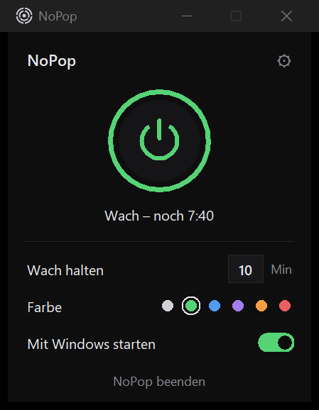

  

<h1 align="center">NoPop</h1>

  <b>Schluss mit dem „Plopp“ aus den Laptop-Lautsprechern, wenn Ton startet oder stoppt.</b> 
  Klein, kostenlos, Open Source. Läuft unauffällig im Infobereich der Taskleiste.

  <a href="../../releases/latest"><b>⬇ Download</b></a> ·
  <a href="README.md">English</a>

---

## Das Problem

Du pausierst ein YouTube-Video, jemand hört auf Discord auf zu reden, ein Lied endet – und die Lautsprecher machen **„Plopp“**.
Viele Laptops (Cirrus Logic, Realtek und andere „Smart-Verstärker“) schalten den Verstärker kurz nach dem Ton ab
und beim nächsten Ton wieder an. Genau dieses Schalten ist das Ploppen.

## Wie NoPop das löst

Sobald irgendein Ton läuft, hält NoPop die Lautsprecher ein paar Minuten wach (du stellst ein, wie lange) – mit einem
**unhörbaren** 20-Hz-Ton bei etwa −70 dB. Pausieren und weiterspielen, so oft du willst: kein Plopp.
Kommt so lange kein Ton, dürfen die Lautsprecher wieder schlafen, und NoPop wartet auf den nächsten Ton.

> Reine digitale Stille reicht nicht: Smart-Verstärker erkennen Stille und schalten trotzdem ab. Deshalb der unhörbare Ton.

  

## Funktionen

- **Ein Knopf**: an / aus
- **X Minuten wach halten** nach dem letzten Ton (Zahl eintippen, 1–240)
- **Startet mit Windows** (auch im Akkubetrieb) – abschaltbar
- **Tray-Symbol** leuchtet in deiner Farbe, solange die Lautsprecher wach gehalten werden
- **Sparsam**: ein Prozess, ca. 25–45 MB RAM, ~0 % CPU beim Warten
- **Privat**: keine Internetverbindung, kein Tracking, kein Konto. Gelesen wird nur der Pegel deines Lautsprechers.
- Deutsch und Englisch (richtet sich nach der Windows-Sprache)

## Installieren

1. `NoPop-x.y.z-windows-x64.zip` aus dem [neuesten Release](../../releases/latest) herunterladen.
2. Rechtsklick auf die ZIP-Datei → **Alle extrahieren**.
3. Im entpackten Ordner **`Install.cmd`** doppelklicken.

Keine Admin-Rechte nötig. NoPop wird nach `%LOCALAPPDATA%\Programs\NoPop` installiert, bekommt einen
Startmenü-Eintrag und öffnet sich. Das Symbol findest du im Infobereich (Pfeil **^** neben der Uhr).

**„Der Computer wurde durch Windows geschützt“?** NoPop ist nicht mit einem kostenpflichtigen Zertifikat signiert,
deshalb kann Windows beim Installationsskript warnen. Auf **Weitere Informationen → Trotzdem ausführen** klicken.
Alles, was NoPop ausführt, steht in diesem Repository, und das mitgelieferte Python ist das offizielle von
python.org, signiert von der Python Software Foundation.

## Deinstallieren

**Einstellungen → Apps → Installierte Apps → NoPop → Deinstallieren.** Entfernt Programm, Autostart,
Startmenü-Eintrag und Einstellungen.

## Häufige Fragen

**Kostet das Akku?** Kaum. Beim Warten braucht NoPop praktisch keine CPU. Beim Wachhalten kostet vor allem
der eingeschaltete Verstärker etwas Strom (grob 0,2–0,5 W) – und nur in den Minuten, die du einstellst.

**Nach einer langen Pause ploppt es beim ersten Ton trotzdem.** Normal: In dem Moment haben die Lautsprecher
wirklich geschlafen. NoPop verhindert das Ploppen *zwischen* den Tönen.

**Bluetooth-Kopfhörer / USB-Audio?** NoPop folgt deinem Standard-Wiedergabegerät und funktioniert damit auch,
das Ploppen tritt aber meist nur bei eingebauten Lautsprechern auf.

## Selbst bauen

Siehe [englisches README](README.md#build-from-source).

## Lizenz

[MIT](LICENSE) – frei nutzbar, veränderbar und weitergebbar.
