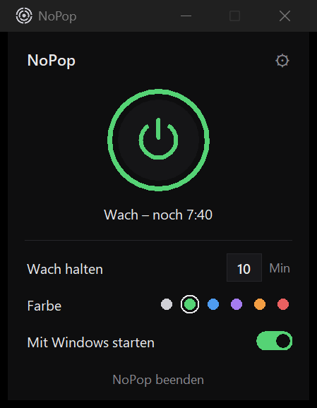

<p align="center">
  
</p>

<h1 align="center">NoPop</h1>

<p align="center">
  <b>Schluss mit dem „Plopp“ aus den Laptop-Lautsprechern, wenn Ton startet oder stoppt.</b><br>
  Klein, kostenlos, Open Source. Läuft unauffällig im Infobereich der Taskleiste.
</p>

<p align="center">
  <a href="README.md">English</a>
</p>

<p align="center">
  <a href="https://github.com/Breitmann177/NoPop/releases/latest/download/NoPop-Setup.exe"></a>
  &nbsp;
  <a href="https://github.com/Breitmann177/NoPop/releases/latest/download/NoPop-Linux.tar.gz"></a>
</p>

<p align="center"><sub><b>Windows:</b> <code>NoPop-Setup.exe</code> doppelklicken &nbsp;·&nbsp; <b>Linux:</b> entpacken → <code>./install.sh</code></sub></p>

---

## Das Problem

Du pausierst ein YouTube-Video, jemand hört auf Discord auf zu reden, ein Lied endet – und die Lautsprecher machen **„Plopp“**.
Viele Laptops (Cirrus Logic, Realtek und andere „Smart-Verstärker“) schalten den Verstärker kurz nach dem Ton ab
und beim nächsten Ton wieder an. Genau dieses Schalten ist das Ploppen.

## Wie NoPop das löst

Sobald irgendein Ton läuft, hält NoPop die Lautsprecher ein paar Minuten wach (du stellst ein, wie lange) – mit einem
**unhörbaren** 20-Hz-Ton bei etwa −70 dB. Pausieren und weiterspielen, so oft du willst: kein Plopp.
Kommt so lange kein Ton, dürfen die Lautsprecher wieder schlafen, und NoPop wartet auf den nächsten Ton.

> Reine digitale Stille reicht nicht: Smart-Verstärker erkennen Stille und schalten trotzdem ab. Deshalb der unhörbare Ton.

<p align="center">
  
</p>

## Funktionen

- **Ein Knopf**: an / aus
- **X Minuten wach halten** nach dem letzten Ton (Zahl eintippen, 1–240)
- **Startet mit Windows** (auch im Akkubetrieb) – abschaltbar
- **Tray-Symbol** leuchtet in deiner Farbe, solange die Lautsprecher wach gehalten werden
- **Sparsam**: ein Prozess, ca. 25–45 MB RAM, ~0 % CPU beim Warten
- **Privat**: keine Internetverbindung, kein Tracking, kein Konto. Gelesen wird nur der Pegel deines Lautsprechers.
- Deutsch und Englisch (richtet sich nach der Windows-Sprache)

## Installieren

### Windows

**[⬇ NoPop-Setup.exe herunterladen](https://github.com/Breitmann177/NoPop/releases/latest/download/NoPop-Setup.exe)** → doppelklicken → fertig.

Keine Admin-Rechte, keine Zusatzsoftware. NoPop öffnet sich und sitzt im Infobereich (Pfeil **^** neben der Uhr).

**„Der Computer wurde durch Windows geschützt“?** Auf **Weitere Informationen → Trotzdem ausführen** klicken.
NoPop ist kostenlos und nicht mit einem bezahlten Zertifikat signiert; der ganze Code steht in diesem Repository.

**Von Smart App Control blockiert?** Stattdessen [NoPop-Windows.zip](https://github.com/Breitmann177/NoPop/releases/latest/download/NoPop-Windows.zip) laden,
Rechtsklick → **Alle extrahieren**, **`Install.cmd`** doppelklicken. Das startet nur das offizielle, signierte Python von python.org.

### Linux

[NoPop-Linux.tar.gz](https://github.com/Breitmann177/NoPop/releases/latest/download/NoPop-Linux.tar.gz) laden, entpacken, im Ordner ein Terminal öffnen und starten:

```bash
./install.sh
```

Installiert nur für deinen Benutzer (ohne root), legt NoPop ins App-Menü und startet es. Fehlen Python/Tkinter
oder `pactl`, bietet es an, sie zu installieren. Läuft mit PipeWire und PulseAudio. Unter Linux gibt es kein
Tray-Symbol: Fenster schließen = NoPop läuft weiter, wieder öffnen über das App-Menü.

## Deinstallieren

**Einstellungen → Apps → Installierte Apps → NoPop → Deinstallieren.** Entfernt Programm, Autostart,
Startmenü-Eintrag und Einstellungen.

**Linux:** `~/.local/share/nopop/uninstall.sh` ausführen.

## Häufige Fragen

**Kostet das Akku?** Kaum. Beim Warten braucht NoPop praktisch keine CPU. Beim Wachhalten kostet vor allem
der eingeschaltete Verstärker etwas Strom (grob 0,2–0,5 W) – und nur in den Minuten, die du einstellst.

**Nach einer langen Pause ploppt es beim ersten Ton trotzdem.** Normal: In dem Moment haben die Lautsprecher
wirklich geschlafen. NoPop verhindert das Ploppen *zwischen* den Tönen.

**Bluetooth-Kopfhörer / USB-Audio?** NoPop folgt deinem Standard-Wiedergabegerät und funktioniert damit auch,
das Ploppen tritt aber meist nur bei eingebauten Lautsprechern auf.

## Selbst bauen

Siehe [englisches README](README.md#build-from-source).

## Code signing policy

Kostenlose Code-Signatur von [SignPath.io](https://about.signpath.io), Zertifikat von [SignPath Foundation](https://signpath.org)
*(Antrag läuft – aktuelle Versionen sind noch nicht signiert)*.

- Committer, Reviewer und Freigabe: [Breitmann177](https://github.com/Breitmann177)
- Jede Version wird automatisch per [GitHub Actions](.github/workflows/release.yml) aus diesem Repository gebaut und von Hand freigegeben.
- Datenschutz: siehe [PRIVACY.md](PRIVACY.md) – NoPop sendet keine Daten.

## Lizenz

[MIT](LICENSE) – frei nutzbar, veränderbar und weitergebbar.
