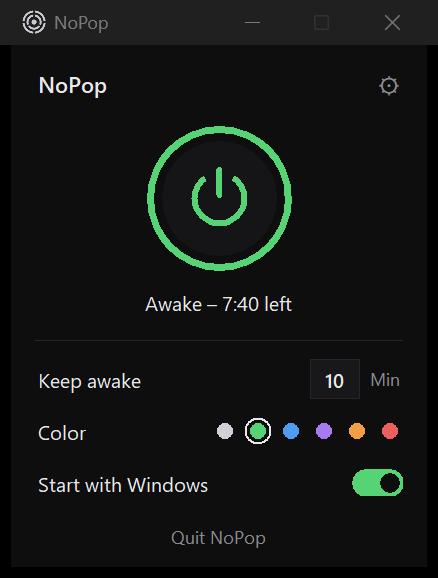

<p align="center">
  
</p>

<h1 align="center">NoPop</h1>

<p align="center">
  <b>Stops the annoying "pop" from your laptop speakers when audio starts or stops.</b><br>
  Tiny, free, open source. Lives quietly in your system tray.
</p>

<p align="center">
  <a href="../../releases/latest/download/NoPop-Setup.exe"><b>⬇ Download NoPop for Windows</b></a> ·
  <a href="README.de.md">Deutsch</a>
</p>

---

## The problem

You pause a YouTube video, a friend stops talking on Discord, a song ends – and your speakers go **"pop"**.
Many laptops (Cirrus Logic, Realtek and other "smart amps") switch the speaker amplifier off a moment after the sound stops,
and switch it back on when the next sound starts. That switching is the pop.

## How NoPop fixes it

When any sound plays, NoPop keeps the speakers awake for a few minutes (you choose how long) by playing an
**inaudible** 20 Hz tone at about −70 dB. Pause and resume as much as you like – no pop.
When nothing has played for that long, NoPop lets the speakers sleep again and waits for the next sound.

> Plain digital silence is not enough: smart amps detect silence and turn off anyway. That's why NoPop uses an inaudible tone.

<p align="center">
  
</p>

## Features

- **One button**: on / off
- **Keep awake for X minutes** after the last sound (type the number, 1–240)
- **Starts with Windows** (also on battery) – optional
- **Tray icon** lights up in your chosen color while the speakers are kept awake
- **Light on resources**: one process, ~25–45 MB RAM, ~0 % CPU while waiting
- **Private**: no internet connection, no tracking, no account. It only reads the volume level of your speaker.
- English and German (follows your Windows language)

## Install

**[⬇ Download NoPop-Setup.exe](../../releases/latest/download/NoPop-Setup.exe)** → double-click → done.

No admin rights, no extra software. NoPop opens and sits in the system tray (click **^** next to the clock).

**"Windows protected your PC"?** Click **More info → Run anyway**. NoPop is free and not signed with a paid
certificate; all its code is in this repository.

**Blocked by Smart App Control?** Download the ZIP from the [latest release](../../releases/latest) instead,
right-click → **Extract All**, double-click **`Install.cmd`**. It only runs the official, signed Python from python.org.

## Uninstall

**Settings → Apps → Installed apps → NoPop → Uninstall.** This removes the program, its autostart entry,
Start menu entry and settings.

## FAQ

**Does it drain my battery?** Barely. While waiting it uses practically no CPU. While keeping the speakers
awake, the main cost is the speaker amplifier staying on (roughly 0.2–0.5 W) – only for the minutes you set.

**It still pops when I start something after a long break.** Expected: at that moment the speakers really
were asleep. NoPop prevents the pops *between* sounds.

**Bluetooth headphones / USB audio?** NoPop follows your default playback device, so it works with them too,
but the pop problem usually only happens on built-in speakers.

## Build from source

Requires Windows 10/11 and Python 3.12 (64-bit) from python.org.

```
python nopop.py                 # run directly (uses only the standard library)
python packaging/build.py       # build dist/NoPop-<version>-windows-x64.zip
iscc /DVersion=x.y.z packaging
opop.iss   # build dist/NoPop-Setup.exe (Inno Setup 6)
```

`logo.py` regenerates the icons (needs Pillow). The `tests/` folder contains small manual checks.

| File | Purpose |
|---|---|
| `nopop.py` | app, window (tkinter), settings, autostart |
| `kern.py` | sound detection (Windows audio meter via COM) and the inaudible keep-awake tone |
| `tray.py` | tray icon via the Windows API |
| `texte.py` | German / English texts |
| `packaging/` | build script, Setup (Inno Setup), ZIP installer |

Releases are built by GitHub Actions: bump `VERSION`, push a tag `vX.Y.Z`.

## Code signing policy

Free code signing provided by [SignPath.io](https://about.signpath.io), certificate by [SignPath Foundation](https://signpath.org)
*(application in progress – current releases are not signed yet)*.

- Committers, reviewers and approvers: [Breitmann177](https://github.com/Breitmann177)
- Every release is built automatically by [GitHub Actions](.github/workflows/release.yml) from this repository and approved by hand.
- Privacy: see [PRIVACY.md](PRIVACY.md) – NoPop sends no data anywhere.

## License

[MIT](LICENSE) – free to use, change and share.
